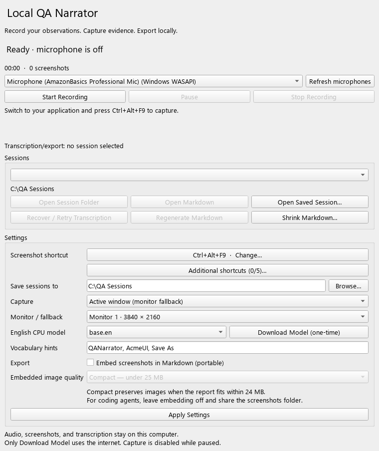
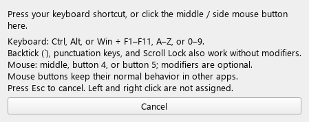
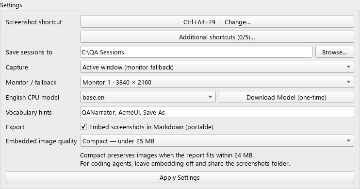

# Local QA Narrator

**Talk through your testing. Turn it into a walkthrough.**

Say what you notice, capture what you see, and export a chronological Markdown
walkthrough with your feedback and screenshots. Local QA Narrator records your
voice and transcribes it on your Windows PC, ready for you to share with a teammate
or coding agent.

**[Download for Windows →](https://github.com/ariesyous/qa-tool/releases/latest)**
Choose **QANarrator-v0.4.0-windows-x64.zip**, then follow the [quick start](#download-and-launch).
Requires Windows 10/11 x64.

Version **0.4.0** adds vocabulary hints, preserves images in reports that already
fit the compact target, and improves microphone, shortcut, and session recovery
reliability. See the [release notes](CHANGELOG.md).

[Quick start](#download-and-launch) · [First walkthrough](#your-first-walkthrough) · [Screenshot shortcuts](#screenshot-shortcuts) · [Portable Markdown](#portable-markdown-with-embedded-screenshots) · [Troubleshooting](#troubleshooting) · [Developer setup](#setup-from-source)



## A little less typing, a lot more context

- 🎙️ **Speak your feedback.** Local transcription turns your recording into text.
- 📸 **Capture it your way.** Use a configurable keyboard or mouse shortcut for screenshots.
- 🔄 **Pick up after an interruption.** Recover incomplete sessions or retry transcription.
- 📄 **Share a walkthrough.** Export Markdown with linked screenshots, or embed them in one file.

Your recordings and screenshots stay on your computer. No accounts, telemetry,
cloud transcription, uploads, LLM analysis, or automatic sharing. The one-time
model download needs internet access; transcription runs locally afterward.

## Download and launch

1. Download **QANarrator-v0.4.0-windows-x64.zip** from the
   [latest release](https://github.com/ariesyous/qa-tool/releases/latest).
2. Extract the ZIP, then double-click **`QANarrator\QANarrator.exe`**.
   Keep the entire extracted `QANarrator` folder together, including `_internal`.
3. Click **Download Model (one-time)** to install `base.en`, or use the
   [offline model setup](#offline-model-setup). Models are not included in the ZIP.

Windows 10/11 x64 is required. The build is unsigned; clean-machine deployment
and SmartScreen reputation have not been tested.

To upgrade, close the older app and extract the new ZIP into a separate folder.
Your saved settings, sessions, and downloaded models can be reused. On non-US
keyboard layouts, record previously saved backtick shortcuts again to adopt the
correct key mapping.

## Your first walkthrough

1. **Set the scene.** Check your microphone. The app initially prefers its
   **Windows WASAPI** entry when available and retains your saved selection.
   In Settings, choose your output folder and capture mode, then apply.
2. **Start talking.** Click **Start Recording**, switch to the app you are reviewing,
   and describe what you notice.
3. **Capture the moment.** Use your screenshot shortcut whenever you want to add
   visual context. The default is **Ctrl+Alt+F9**; [make it your own](#screenshot-shortcuts)
   in Settings. The taskbar flashes on success without stealing focus or overlaying
   your screenshot.
4. **Take a breather.** Use **Pause/Resume** when needed. Paused audio is discarded
   and screenshot presses are ignored; the shortcut stays reserved until Stop.
5. **Wrap up and share.** Click **Stop Recording**. Local CPU transcription and
   export run in the background. Use **Open Markdown** or **Open Session Folder**
   to find the result. Share `feedback.md` together with its `screenshots` folder,
   or [embed screenshots](#portable-markdown-with-embedded-screenshots) to share one Markdown file.
   You can also share the full session yourself.

Recording continues while minimized. The microphone remains open during Pause so
resume is immediate, but paused samples are neither queued nor written. Closing is
blocked during recording/processing; minimize the window to leave it working.
If a requested screenshot is still waiting for capture when Pause or Stop takes
effect, a message explains that the screenshot was skipped.

## Screenshot shortcuts

**Your shortcut, your choice.** The screenshot hotkey is configurable and defaults
to **Ctrl+Alt+F9**. In **Settings → Screenshot shortcut**, record a keyboard
combination or a **middle / side mouse button** (buttons 4 and 5), optionally with
Ctrl/Alt/Shift/Win.

**Backtick (\`), punctuation keys, and Scroll Lock** can also be used on their own,
without modifiers. Record a key in the picker to use it as your main shortcut or an
additional one. The picker remembers the Windows key code of the key you pressed,
including on non-US layouts, and accepts Shift+backtick (tilde). Previously saved
backtick shortcuts keep their original US-key mapping; record the shortcut again
to use your layout's key.

Keep just the default shortcut, or open **Additional shortcuts** to add up to five
more (six total). You can change or remove each additional shortcut. All configured
shortcuts use the same capture settings. Duplicate combinations are rejected, and
a registration conflict keeps your previous shortcuts.

Keyboard shortcuts are reserved only while a recording is active (Start through
Stop). Windows delivers a registered shortcut to QA Narrator instead of the focused
app, so while you are not recording, those keys work normally everywhere else —
including a standalone backtick. Settings checks each change for conflicts and
releases it again; Start checks once more before the microphone opens.

The captured shortcut saves immediately. Esc or Cancel keeps your previous shortcut.
Left and right clicks are not assigned. Mouse shortcuts pass through, so the button
also retains its normal behavior in the reviewed app.
All mouse bindings share one hook on a dedicated message thread so GUI or disk
stalls do not block the hook's message loop.



## Sharing with coding agents

**For coding agents, use linked images.** Leave **Embed screenshots in Markdown**
off (the default). For an existing embedded report, turn embedding off and click
**Regenerate Markdown**, confirming replacement if you have edited the report.

Share `feedback.md` together with its `screenshots` folder, preserving their relative
paths. You can zip those files together. Audio is not needed for this handoff.
Ask the agent to open the referenced screenshots as images as it reads your feedback.

Embedded images are stored as long base64 lines that can exceed an agent's text
reading limits. Compact export reduces file size but still uses one long line per
image. If only an embedded report is available, extract its data URLs to image files
before asking the agent to inspect the screenshots.

The equivalent command-line export is:

```powershell
uv run qa-narrator --export "C:\path\to\session" --linked-images
```

## Portable Markdown with embedded screenshots

Use embedded export when you need a single file for a viewer that supports data-URL
images. For coding agents, use the [linked-image handoff](#sharing-with-coding-agents).

Enable **Settings → Export → Embed screenshots in Markdown (portable)**.
The preference saves immediately. New sessions embed their screenshots on export.
For an existing session, select it and click **Regenerate Markdown**; no new recording
or transcription is required. Uncheck the option and regenerate to return to relative
image links. Existing manual edits still require confirmation before replacement.
Export encoding runs in the background so large screenshots do not freeze the UI.



With this option, share **only `feedback.md`**. Choose **Embedded image quality**:

- **Compact — under 25 MB** (the UI default): targets at most **24,000,000 bytes**
  for the complete Markdown, including text and base64. If the report already fits,
  images keep their original bytes, format, and resolution. Only oversized reports
  are compressed, starting at a maximum longest edge of 2560 pixels with JPEG
  quality 90. PNG is retained when smaller;
  transparent images stay PNG. If necessary, the exporter tries lower settings,
  stopping at a longest edge of 1920 pixels and JPEG quality 80. Small images are
  never enlarged. Compression can soften small text; original captures are retained.
  If the report still cannot fit, export stops with an explanation and keeps the
  previous file. Split the report, use linked images, or select raw output.
- **Raw — original PNGs, no size limit**: embeds the original PNG bytes exactly,
  preserving full resolution. Use this when original image fidelity matters most.

The app and CLI report the final file size, warn from 20 MB, and flag files at or
above 25 MB. Existing sessions also show the current Markdown size when selected.
MB here means 1,000,000 bytes, leaving room beneath either a 25 MB or 25 MiB limit.
The 24 MB budget and 25 MB sharing threshold are application targets, rather than
a promise about a specific upload destination. Check the destination's own limits.

To shrink a report you already created, click **Shrink Markdown…** and select the
file. This works without the original session and saves `name.compact.md` beside it
(or a numbered copy if that name exists). It compresses embedded PNG/JPEG images,
preserving all other bytes, including manual notes. The original Markdown stays
untouched. Linked images are not embedded or resized by this action.
If the file already fits the 24 MB target, the new copy is byte-for-byte identical,
and the progress message explains that images were kept unchanged.

During shrinking or compact export, an animated activity bar and status text show
the current screenshot and compression pass, followed by assembling and saving.
Additional passes run only if needed to meet the size target; the bar indicates
ongoing work rather than an estimated percentage or time remaining.

**Shrink Markdown…** also shows a **Cancel** button beside the activity bar.
Cancellation waits for the current image or file operation to finish, then stops
without saving a compact copy. The original and any earlier compact copies stay
untouched. The app shows “Cancelling…” until the worker stops, then lets you retry.
If the copy was already saved before cancellation reached it, the app reports
the completed copy instead. This button applies to standalone shrinking.

Embedded images use `data:image/png;base64,...` or `data:image/jpeg;base64,...` URLs.
The source screenshots and audio remain in the session folder. The exported document
contains the feedback and screenshots; audio is not embedded. Base64 adds roughly
one third to the image data size, so the Markdown can be large.

Data-URL image display depends on the viewer. Some renderers filter these URLs;
[GitHub's markup tracker](https://github.com/github/markup/issues/1614) documents this
limitation. Reading encoded text alone is not equivalent to viewing an image.
Relative-image export remains the default for compatibility.

<details>
<summary>Command-line export options</summary>

```powershell
uv run qa-narrator --export "C:\path\to\session" --embed-images
uv run qa-narrator --export "C:\path\to\session" --embed-images --image-quality compact
uv run qa-narrator --export "C:\path\to\session" --embed-images --image-quality raw
uv run qa-narrator --export "C:\path\to\session" --linked-images
uv run qa-narrator --shrink-markdown "C:\path\to\feedback.md"
```

Image mode and quality flags also work with `--process`. When omitted, CLI
regeneration uses that session's last successful settings (linked images and raw
quality for older sessions). `--image-quality` only affects embedded exports.

</details>

## Session files and recovery

An interrupted walkthrough does not have to mean starting over. Choose an incomplete
session and click **Recover / Retry Transcription** to recover the saved recording
or retry transcription.

<details>
<summary>Session files, recovery behavior, and command-line tools</summary>

```text
qa-sessions/2026-10-09_184500_a1b2c3d4/
  feedback.md
  session.json
  transcription.json
  audio.wav
  audio.pcm
  screenshots/
    001.png
    001.json
```

`session.json` stores settings, state, ordered events, clock calibration, and timing.
`transcription.json` stores original recognized text and word timestamps. Each PNG
has a small timing sidecar so recovery can restore a capture interrupted while
updating the session index. Filenames are sequential and Markdown links are relative.

Microphone buffers go to a separate writer, which persists mono signed 16-bit PCM
incrementally and requests a disk flush approximately every second during capture.
Audio is converted to WAV on Stop. Keep `audio.pcm` until you no longer need crash
recovery; both files are retained deliberately, roughly doubling audio storage.
Metadata and PNGs use flushed temporary files plus atomic replacement.
Warnings and pause/resume metadata are retained in memory and saved by the writer
approximately once a second, including while paused. A failed metadata save reports
a warning and is retried without stopping audio capture. Stop finalizes the WAV
before reporting any metadata save failure that remains.
Power loss can still lose recent buffers or writes held by storage hardware.

On restart, choose an incomplete session and click **Recover / Retry Transcription**.
**Open Saved Session…** opens sessions from other directories. Recovery rebuilds the
WAV from complete PCM samples. It never deletes previous recordings or screenshots.
An interrupted transcription can be retried without recording again.

**Regenerate Markdown** uses the saved transcript. Automatically generated output
can be replaced; if its bytes have changed, replacement requires confirmation.
Transcription retry also preserves manually edited Markdown.
After a successful retry, the app reports that the transcript was updated and your
edited Markdown was kept. Use **Regenerate Markdown** for confirmed replacement.

Command-line recovery/export:

```powershell
uv run qa-narrator --process "C:\path\to\session"
uv run qa-narrator --export "C:\path\to\session"
```

CLI export refuses to overwrite edited Markdown. Transcription retry keeps your
edits and reports the updated transcript. Use the UI for confirmed replacement.

</details>

## Offline model setup

**Download Model (one-time)** is the only application action that accesses the
internet. It fetches public faster-whisper model files from Hugging Face. `base.en`
with CPU int8 is the default; `tiny.en` trades accuracy for speed, and `small.en`
trades processing time and memory for accuracy. All three are English models.

Models live in `%LOCALAPPDATA%\QANarrator\models\<model-name>`. For an offline
machine, copy the entire downloaded model directory there. It must include
`model.bin`, `config.json`, `tokenizer.json`, and `vocabulary.txt`.
Set `QA_NARRATOR_MODEL_DIR` to use another model root (containing `base.en`, etc.).
Normal inference always loads an existing local directory with local-only loading;
it does not silently download missing models. Failed inference preserves the session.

### Vocabulary hints

Enter a few product names, UI terms, acronyms, or short phrases in **Settings →
Vocabulary hints**, for example `QANarrator, AcmeUI, Save As, OAuth`. Apply Settings
saves the preference; starting a recording or retrying transcription also saves it.
The current field is used for new transcription and retries. Leave it empty to
disable hints. Hints guide recognition but do not guarantee a spelling or replace
reviewing the transcript. They work locally with the existing English CPU models.

The chosen vocabulary is saved in `session.json` and the successful
`transcription.json`. The CLI reuses the session's saved vocabulary when omitted;
pass `--vocabulary` to override it, or `--vocabulary=` to clear it:

```powershell
uv run qa-narrator --process "C:\path\to\session" --vocabulary "QANarrator, AcmeUI, Save As"
uv run qa-narrator --process "C:\path\to\session" --vocabulary=
```

Hints apply during recognition. Regenerate Markdown uses the saved transcript;
use **Recover / Retry Transcription** to apply changed hints to existing audio.

## Troubleshooting

- **Start disabled:** connect/refresh a microphone and resolve any shortcut registration
  error in Settings. F12 is reserved by Windows and intentionally rejected. Another app
  can claim a shortcut while QA Narrator is idle; Start then reports the conflict, stays
  disabled, and does not open the microphone. Close the other app and click **Apply
  Settings**, or choose another shortcut.
- **Hotkey conflict:** close the competing app or choose another modifier plus F1–F11,
  letter, or digit. Windows error 5 indicates access denied (including restricted
  sandboxes). Run the app normally on your interactive desktop.
- **No audio/device error:** allow desktop microphone access in Windows privacy settings;
  check device connections, selected input, and exclusive access by other applications.
  If a newly connected device does not appear after Refresh, restart QA Narrator to
  reinitialize PortAudio's device enumeration.
- **Model missing:** download it explicitly, or copy the complete directory for offline
  use. Audio remains saved if Stop cannot transcribe.
- **Black screenshot:** try monitor mode for the visible application. Protected content
  may be unavailable in any mode. An entirely black but legitimate screen is also rejected.
- **Disk full:** free space in the output location, reopen the session and recover. Do
  not delete its PCM or screenshot sidecars before recovery.
- **Markdown won't open:** associate `.md` with VS Code or your preferred editor in Windows.

## Timing and capture tradeoffs

Read these details when planning longer recordings or investigating capture and
transcription behavior.

<details>
<summary>Timing, transcription accuracy, capture limits, and device behavior</summary>

- Audio and screenshots use one monotonic active-session timeline. Pauses are removed
  from both. PortAudio ADC timestamps are bridged to Python's monotonic clock and audio
  buffers are cropped at pause boundaries. Missing ADC timestamps use a continuous
  sample clock anchored to the first callback minus reported input latency, using
  at least one buffer duration; the session records a warning. Subsequent callback
  jitter does not change that anchor. After overflow, fallback timing is reanchored
  and explicitly marked as estimated. Driver latency inaccuracies and clock drift
  can still affect timing. WASAPI is preferable to legacy MME drivers.
- Screenshots use the time immediately before the pixel grab, with the shortcut request
  time also retained. Screenshots inside a transcribed word follow that whole word;
  equal-time screenshots precede words starting at that time. Multiple screenshots
  within one sentence are supported. Missing/inconsistent word boundaries use evenly
  spaced original segment tokens, explicitly marked as estimates in the document.
- Whisper recognition and word timings are estimates. Errors or invented words can
  occur, including on silence. No second model rewrites the result. Original audio
  and the full transcript remain available for checking.
- Active-window capture uses visible screen pixels clipped to the window's DWM bounds.
  It includes overlapping windows, cannot capture hidden content, and may not work with
  protected surfaces, secure desktops, or exclusive fullscreen rendering. Invalid
  window bounds fall back to the selected monitor and report that fallback.
  Switch away from QA Narrator before capturing. Monitor/all-monitor modes may include
  other visible windows. All-black/empty captures are rejected and PNGs are validated.
- Windows per-monitor DPI awareness is enabled before creating windows. Monitor
  positions can be negative. Select the monitor again after changing display topology.
- Input overflow records a timestamped warning and recording continues, with missing
  audio represented by silence when its timing can be determined. Without reliable
  ADC timestamps, the gap is estimated from the callback clock and input latency;
  its duration can be inaccurate. Disconnects, unresponsive devices, other stream
  status errors, and audio write failures still end recording and preserve the
  saved portion; reconnect and start a new session. The app does not splice device
  changes into an existing recording. Sleep/suspend during recording is unsupported.
- A session must fit standard WAV's 4 GB limit (many hours for mono audio). CPU inference
  can take time and is not cancellable in v1. The UI stays responsive during inference.

</details>

## Setup from source

Use Windows x64, Python 3.12 or 3.13, and [uv](https://docs.astral.sh/uv/getting-started/installation/):

```powershell
uv python install 3.12
uv sync --locked --extra dev
uv run qa-narrator --download-model base.en
uv run qa-narrator
```

`uv.lock` pins the tested dependency set. Without uv, create a Python 3.12 virtual
environment and run `python -m pip install -e ".[dev]"`; this resolves within the
declared compatible ranges instead of using the lock. Microsoft Visual C++ 2015–2022
x64 Redistributable may be needed if an inference DLL cannot load.

## Build and test

GitHub Actions runs [CI](.github/workflows/ci.yml) on every push and pull request,
and can also be started manually from the Actions tab. Each run checks Ruff lint
and the full pytest suite on Windows with Python 3.12 and 3.13, using `uv.lock`.
Qt tests run offscreen. Microphone, desktop capture, transcription-model, and
packaged-app smoke checks remain manual; see [VALIDATION.md](VALIDATION.md).

<details>
<summary>Build commands and packaging notes</summary>

```powershell
uv sync --locked --extra dev
New-Item -ItemType Directory -Path .validation -Force | Out-Null
uv run pytest -q --basetemp=.validation/pytest
uv run ruff check src tests scripts/package_release.py scripts/smoke_release.py
.\scripts\build.ps1
```

For a versioned release package, build into its release directory and package the
complete application folder, documentation, and bundled dependency licenses:

```powershell
.\scripts\build.ps1 -OutputDirectory dist/v0.4.0
uv run python scripts/package_release.py
```

The packaging script reads the source version, verifies the embedded executable
version, checks the ZIP contents and CRCs, and writes `SHA256SUMS.txt` beside the ZIP.

The PyInstaller build is a portable **one-folder** Windows x64 distribution. Models
are not embedded. It is unsigned; distribution/signing and a clean-machine install
test are separate from building locally. PyAV is constrained below 17 because version
19 removed `metadata_errors`, used by the tested faster-whisper release.
Use the build script: it isolates DLL lookup from unrelated tools on your `PATH`.

See [VALIDATION.md](VALIDATION.md) for actual results, native smoke-test commands,
and the human acceptance checklist. Automated mocks do not prove native integration.

</details>

## Source layout

`capture.py` / `timeline.py` / `windows.py` handle recording and capture; `storage.py`
handles durable sessions; `transcription.py` handles local inference; `export.py`
handles deterministic Markdown; `ui.py` provides the PySide6 interface. No database,
plugin system, service container, or agent integration is used.

## Future ideas (not implemented)

- Region capture and optional cursor capture.
- Cancellable transcription with measured progress.
- Signed distribution and additional tested microphone/display configurations.

## License

The application source is available under the [MIT License](LICENSE).
Bundled dependencies retain their own licenses, included in the portable distribution.
